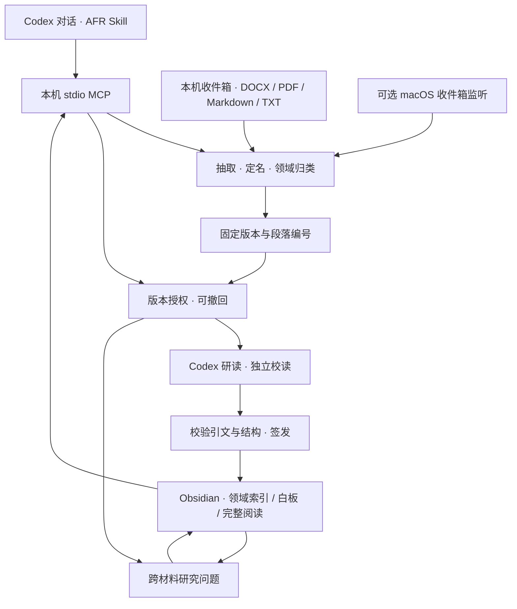

# AFR for Codex 架构

AFR 为 Codex 提供收录和研究工具，为 Obsidian 生成便于阅读、可以追溯出处的资料。安装目标是一个独立目录和两个可选的用户工作目录。

## 一篇材料如何进入库

本机抽取器规范化段落，记录文件字节的 SHA-256，将版本原件和证据留在库里。重复扫描同版文件复用记录。文件标题和领域可以在本机得出。普通收录工具只返回状态和固定版本，可选的文件名改动仅用于通用导出名。

获授权后，文章工作使用现有 Codex CLI 账号分阶段研读及独立校读。每次结构化调用处于独立临时工作目录，使用只读沙箱和临时会话，禁用 Shell、网页搜索和额外工具。校读产物中的引用需能回指固定原文。只有通过程序校验的产物才进入正式白板和完整阅读。白板使用论述、证据与逻辑关系，完整阅读复用论述结构。

研究问题工作使用已签发且已授权来源。符合已有研究问题范围的证据可以补充进旧题。没有已有问题的方向保留为候选，用户确认具体候选后才加入 Obsidian 研究问题索引。确认时重新校验每篇材料的授权和固定版本。查询沿研究问题、论述、固定段落返回出处。经用户确认的讨论写入使用版本校验并保留历史。

## 安装边界

| 部分 | 位置 |
| --- | --- |
| Codex 安装目录和可发现的插件 | `.agents/plugins/marketplace.json`、`plugins/afr-for-codex/plugin.json` |
| Skill 与模型可见工具 | `skills/afr/SKILL.md`、`mcp.json`、`runtime/afr_share/server.py` |
| 隔离依赖和独立配置 | `runtime/launcher.sh`、`runtime/bootstrap.py`、`runtime/afr_share/config.py` |
| 本机研读、签发、研究问题 | `runtime/afr_agent/` |
| 可选监听 | `runtime/afr_share/watch.py` |
| 固定版本、白板、阅读和问题 | 用户选择的 Obsidian 库目录 |

插件状态和新建的默认库放在 `~/Library/Application Support/AFR for Codex`。库标识用于校验当前插件实例的写入权。监听是当前用户登录会话的独立服务，启动时固定历史版本集合。若选择自动研读，只有当前会话中监听启动后新收录的版本才自动获准。服务退出后，工具会回到逐篇授权。停止监听会关闭未来自动授权。插件可独立安装、更新或停用。

MCP 通过固定版本和本机授权文件限制读取与后台处理。聊天内和用户确认时使用的 `confirm` 是 MCP 请求参数。需要客户端逐次确认时，可以启用 Codex 的工具审批提示。
